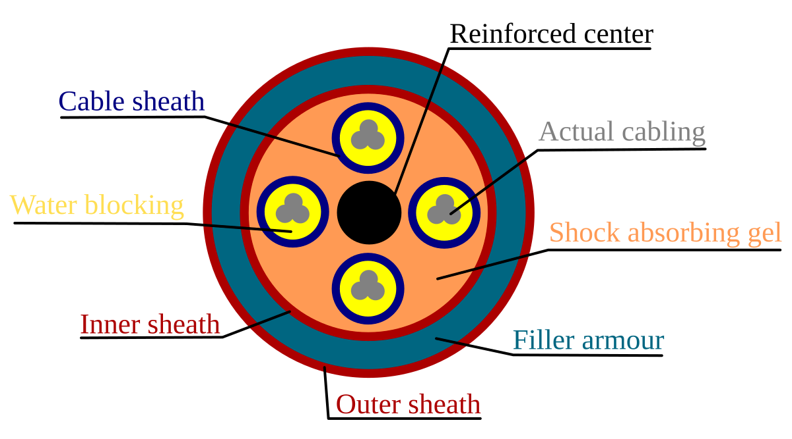

# Cavo Direct-Buried (DBC)
---
Cavo progettato per essere interrato. 

### Come funziona?
La guaina e la struttura del cavo sono progettate per resistere all'umidità e alle condizioni del terreno:

Qui una foto:

Dentro una copertura di questo tipo ci puoi mettere fibra ottica, rame o altre diavolerie.

---
[[Cavo Ethernet (su rame)]]
[[Cavo Ethernet (in fibra ottica)]]
[[Cavo Ethernet (coassiale)]]