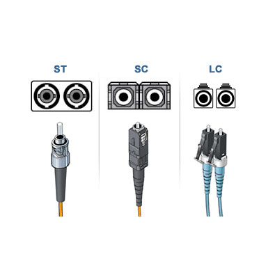

# Cavo Ethernet (in fibra ottica)
---
Cavo utilizzato per collegare tra loro dispositivi di rete, tramite impulsi luminosi trasmessi su fibre ottiche.

### Come funziona?
Una fibra ottica è un sottilissimo filo di vetro o plastica, un cavo in fibra ottica sfrutta la rifrazione della luce all'interno di questo tubicino per propagare un segnale; se vuoi saperne di più, guardati [questo video di Linus](https://www.youtube.com/watch?v=G1Ke-H8I1uk&pp=ugMICgJpdBABGAHKBRFsaW51cyBvcHRpYyBmaWJlcg%3D%3D).

### Tipi di fibre ottiche
Le distingui in base al diametro del nucleo e alle modalità con cui la luce si propaga al suo interno: multimodale (multimode) e monomodale (single-mode).

| Caratteristica                | Fibra multimodale                                     | Fibra monomodale                              |
| ----------------------------- | ----------------------------------------------------- | --------------------------------------------- |
| Dimensione del nucleo         | 50 o 62,5 µm                                          | 8–10 µm                                       |
| Modalità di trasmissione      | Propaga più modalità (raggi di luce) simultaneamente. | Propaga una sola modalità.                    |
| Distanza di trasmissione      | Breve (fino a 2 km)                                   | Lunga (fino a 80–100 km e oltre)              |
| Larghezza di banda            | Più bassa rispetto alla monomodale                    | Molto alta, fino a 100 Gbps e oltre           |
| Costo del cavo                | Economico                                             | Costoso                                       |
| Applicazioni tipiche          | LAN, data center, applicazioni interne                | Telecomunicazioni, dorsali di rete (backbone) |
| Prestazioni su lunga distanza | Limitate dalla dispersione intermodale                | Più affidabile, meno dispersione              |
| Installazione                 | Più semplice                                          | Complessa                                     |

### Il connettore
I cavi in fibra ottica hanno dei connettori che per forza di cose si suddividono in due tubicini (detti send e receive); la luce riflessa non può viaggiare in direzione contraria a quella dal quale è partita, quindi hai un tubicino per ogni direzione:

### Cavi Direct-buried (DBC)
Specificatamente progettati per essere interrati, vedi [[Cavo Direct-Buried (DBC)]].

---
[[Cavo Ethernet (su rame)]]
[[Cavo Ethernet (coassiale)]]