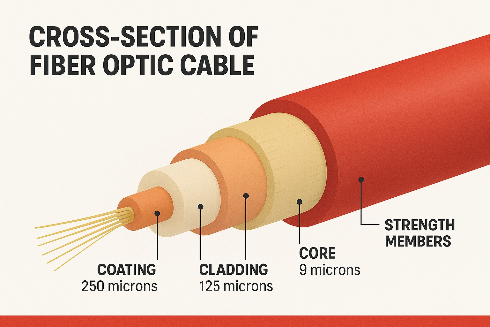

# Cavo Ethernet (in fibra ottica)
---
Cavo utilizzato per collegare tra loro dispositivi di rete, tramite impulsi luminosi trasmessi su fibre ottiche.

### Come funziona?
Una fibra ottica è un sottilissimo filo di vetro o plastica, un cavo in fibra ottica sfrutta la rifrazione della luce all'interno di questo tubicino per propagare un segnale; se vuoi saperne di più, guardati [questo video di Linus](https://www.youtube.com/watch?v=G1Ke-H8I1uk&pp=ugMICgJpdBABGAHKBRFsaW51cyBvcHRpYyBmaWJlcg%3D%3D).

Internamente è diviso in strati:

- **Il core:** lo strato più interno che trasporta la luce, in vetro o plastica.
- **Il cladding:** circonda il core e mantiene la luce al suo interno riflettendola.
- **Lo strato protettivo (buffer):** protegge la fibra dai danni fisici.
- **La guaina esterna:** protegge il cavo dall'ambiente esterno.

### Tipi di fibre ottiche
La luce all'interno del nucleo della fibra ottica può propagarsi lungo percorsi diversi, detti modi, a seconda di come il cavo è stato costruito e pensato:

- **Fibra multimodale (MMF):** ha un core più ampio che permette alla luce di propagare più modi. È utilizzata soprattutto per collegamenti (relativamente) brevi, es. tra dispositivi all'interno di un edificio o di un data center. Il fatto che sia percorsa da diversi modi fa sì che la luce arrivi a destinazione in momenti differenti, limitando la distanza che può raggiungere nei limiti di una certa velocità; si chiama dispersione modale.

- **Fibra monomodale (SMF):** ha un core molto più piccolo che consente la propagazione di un solo modo. Riduce la dispersione modale e permette di trasmettere dati su distanze molto più lunghe, ad esempio tra edifici o città. 

Qui una tabella specifica:

| Caratteristica                | Fibra multimodale                       | Fibra monomodale                               |
| ----------------------------- | --------------------------------------- | ---------------------------------------------- |
| Dimensione del nucleo         | 50 o 62,5 µm (micrometri)               | 8–10 µm (micrometri)                           |
| Modalità di trasmissione      | Propaga più modalità simultaneamente.   | Propaga una sola modalità.                     |
| Distanza di trasmissione      | Fino a 2 km.                            | Fino a 80–100 km e oltre.                      |
| Larghezza di banda            | Più bassa rispetto alla monomodale.     | Fino a 100 Gbps e oltre.                       |
| Costo del cavo                | Economico                               | Costoso                                        |
| Applicazioni tipiche          | LAN, data center, applicazioni interne. | Telecomunicazioni, dorsali di rete (backbone). |
| Prestazioni su lunga distanza | Limitate dalla dispersione intermodale. | Più affidabile, meno dispersione.              |
| Installazione                 | Più semplice.                           | Complessa.                                     |
| Sorgente luminosa             | LED o VCSEL                             | Laser                                          |

### Standard Ethernet su fibra ottica
Qui una tabella:

| Nome comune                   | Standard IEEE | Velocità | Tipo di fibra            | Lunghezza massima                      |
| ----------------------------- | ------------- | -------- | ------------------------ | -------------------------------------- |
| 1000BASE-LX (Long Wavelength) | IEEE 802.3z   | 1 Gbps   | Multimodale o monomodale | 550 m (multimodale); 5 km (monomodale) |
| 10GBASE-SR (Short Reach)      | IEEE 802.3ae  | 10 Gbps  | Multimodale              | 400 m                                  |
| 10GBASE-LR (Long Reach)       | IEEE 802.3ae  | 10 Gbps  | Monomodale               | 10 km                                  |
| 10GBASE-ER (Extended Reach)   | IEEE 802.3ae  | 10 Gbps  | Monomodale               | 30 km                                  |

### Il connettore
I cavi in fibra ottica hanno dei connettori che per forza di cose si suddividono in due tubicini (detti send e receive); la luce riflessa non può viaggiare in direzione contraria a quella dal quale è partita, quindi hai un tubicino per ogni direzione:

### Cavi Direct-buried (DBC)
Specificatamente progettati per essere interrati, vedi [[Cavo Direct-Buried (DBC)]].

---
[[Cavo Ethernet (su rame)]]
[[Cavo Ethernet (coassiale)]]
[[SFP (Small Form-factor Pluggable)]]